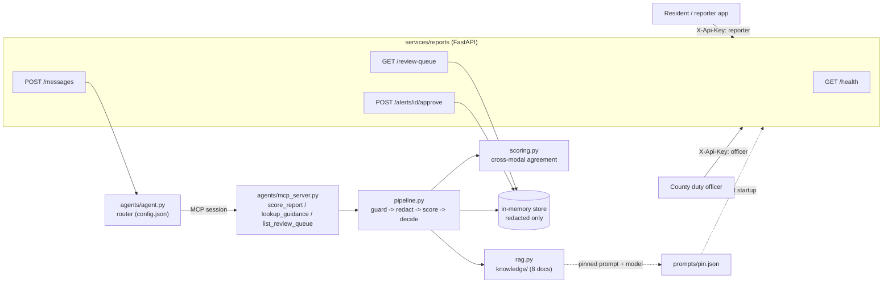

# Architecture

FloodLens Kenya is one FastAPI service, an agent that calls tools over MCP, and a pure-Python
scoring pipeline. Everything runs in stub mode with no API key.

## Module boundaries
| Module | Responsibility | Never does |
|---|---|---|
| `services/reports/app.py` | HTTP, auth, validation, response envelope | log report text |
| `services/reports/auth.py` | API key -> role (reporter, officer); fail closed in live mode | store key values in git |
| `agents/router.py` | keyword routing from `config.json` | call a model |
| `agents/agent.py` | route, role check, call the tool over MCP | touch raw photos |
| `agents/mcp_server.py` | expose three tools to any MCP client | return report text from the queue |
| `services/reports/pipeline.py` | guard, redact, score, decide, draft alert, store | broadcast anything |
| `services/reports/scoring.py` | agreement score, severity, decision rules | drop a report |
| `services/reports/rag.py` | retrieve from `knowledge/`, answer with citations | answer without citing |
| `services/reports/pins.py` | load and verify `pin.json` (prompt sha256) | let an un-pinned prompt run |

## Decision rules (scoring.py)
1. Injection suspected -> `review` (possible_injection)
2. Kiswahili or Sheng -> `review` (language_review)
3. No photo -> `review` (no_image_evidence)
4. Score >= 0.5 -> `draft_alert` (still needs officer approval)
5. Score >= 0.2 -> `review` (weak_agreement)
6. Else -> `low_priority_review`. Kept, never deleted.

Score = share of the report's flood claims the photo confirms. A photo with no water scores 0.
A photo **with** water never scores below 0.35, so it always reaches a person (the missed-alarm floor).

## Data flow and privacy
Report text is redacted (emails, Kenyan phone numbers) before it is stored or returned. Photos with a
person get a privacy marker in place of the reference. The review queue and MCP tool expose ids,
scores and reasons only. Logs carry ids, county, decision and score.
